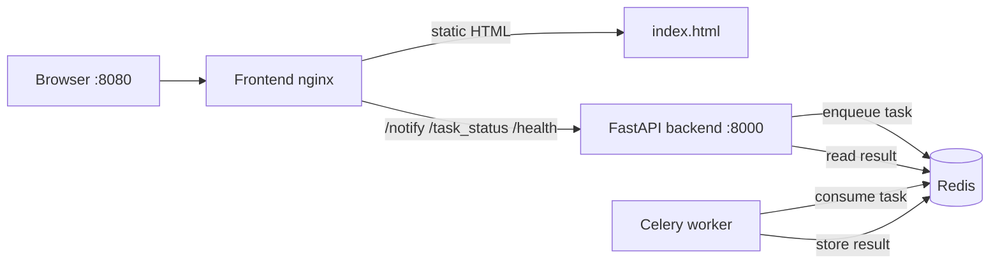
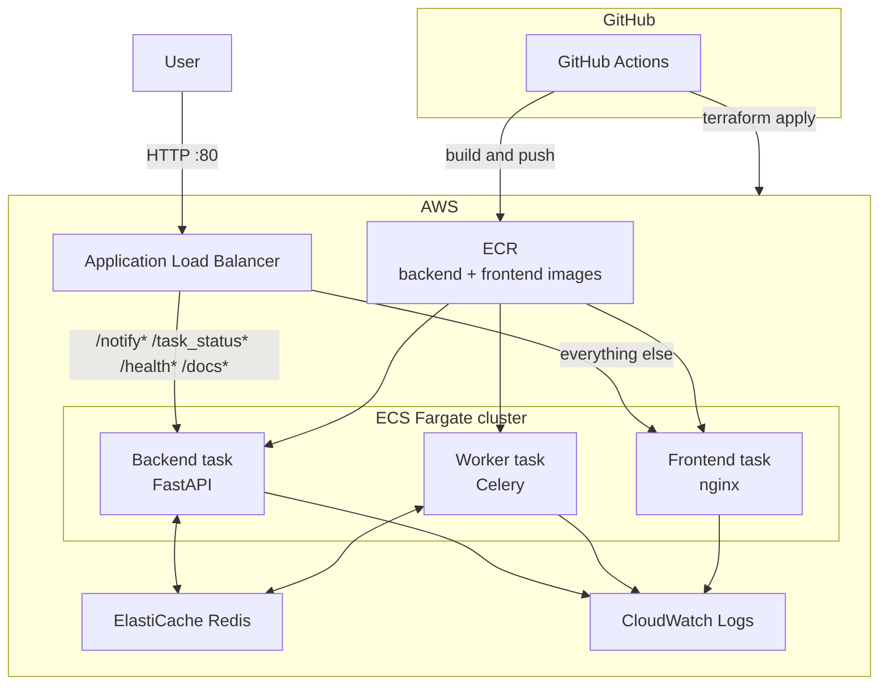

# Architecture

The local stack and the AWS stack expose the same API contract. The frontend calls `POST /notify/` then polls `GET /task_status/{task_id}` until Celery finishes.

## Local containers

Open `http://localhost:8080`. Nginx serves the single-page app and proxies API paths to the backend so the browser can use relative URLs with no CORS setup.

## AWS production

Managed services are used wherever a self-hosted equivalent would add operational work: ElastiCache instead of a Redis container, ECS Fargate instead of EC2, ECR for images, CloudWatch for logs.

Path-based routing on one ALB keeps the frontend and API on the same origin. The SPA therefore uses relative URLs in production the same way it does locally.

## Request path

1. Browser submits an email to `POST /notify/?email=...`.
2. FastAPI enqueues `write_log_celery` on Redis and returns a `task_id`.
3. The Celery worker picks up the task, waits 10 seconds, writes a log line, and stores the result in Redis.
4. The browser polls `GET /task_status/{task_id}` every two seconds until the status is `completed` or `failed`.

## Network choices

ECS tasks run in public subnets with public IPs so they can pull from ECR without a NAT gateway. Redis is still private: ElastiCache has no public endpoint, and its security group only accepts port 6379 from the backend and worker security groups. The ALB is the only internet-facing entry point.
